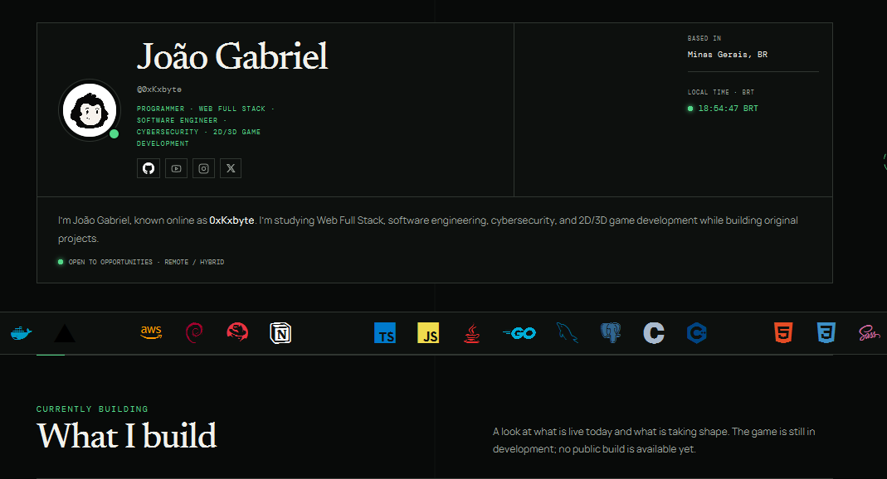

# 0xKxbyte Portfolio Desktop

Aplicação desktop desenvolvida com **Java 21, JavaFX, HTML5, CSS3 e JavaScript**, criada para apresentar meu portfólio pessoal em uma janela nativa do Windows.

## 🖥️ Interface da aplicação

<p align="center">
  
</p>

<p align="center">
  <i>Interface do 0xKxbyte Portfolio Desktop no Windows.</i>
</p>

## 🚀 Tecnologias utilizadas

- **Java 21 (LTS)** — Linguagem principal.
- **JavaFX** — Interface gráfica desktop.
- **JavaFX WebView** — Renderização do portfólio.
- **HTML5** — Estrutura da interface.
- **CSS3** — Estilização.
- **JavaScript** — Interatividade.
- **Apache Maven** — Gerenciamento de dependências.
- **Git e GitHub** — Versionamento.

## ✨ Funcionalidades

- Janela nativa do Windows.
- Botões nativos de minimizar, maximizar e fechar.
- Interface sem barra de endereço.
- Renderização de HTML, CSS e JavaScript.
- Rolagem vertical.
- Links externos abertos no navegador padrão.
- Integração com o GitHub.

## 💻 Compatibilidade

| Sistema operacional | Suporte |
|---------------------|---------|
| Windows 10/11       | Principal |
| Linux               | Requer recompilação e testes |
| macOS               | Não testado |

> **Importante:** o projeto foi desenvolvido principalmente para Windows. Para utilizar no Linux, é necessário configurar o ambiente JavaFX e recompilar a aplicação para a plataforma.

## 📦 Instalação

### 1. Clonar o repositório

```bash
git clone https://github.com/0xKxbyte/0xKxbyte-Portfolio-Desktop.git
```
